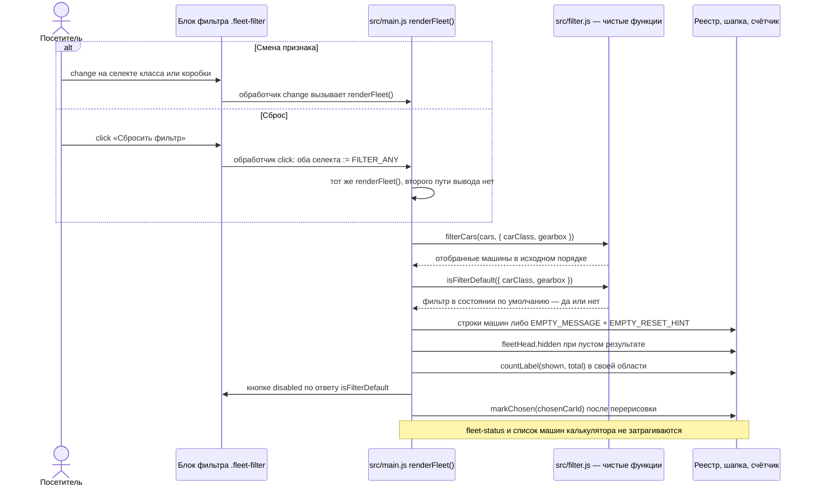

# Design

## Context

Мотивация — в `proposal.md` (раздел Why), требования — в `specs/fleet-filtering/spec.md`.

Текущее устройство, которое задаёт рамки:

- `src/filter.js` — чистые функции без DOM: `filterCars`, `filterOptionsHtml`, `countLabel`, `FILTER_ANY = 'any'`, `EMPTY_MESSAGE`. Значение «любой» — явная строка `'any'`, отсутствие значения тоже читается как «любой» (`isAny`).
- `src/main.js` — единственное место с DOM. Функция `renderFleet()` — единственный путь вывода реестра: она читает значения селектов, фильтрует, пишет строки либо блок пустого результата, переключает `fleetHead.hidden`, обновляет `#fleet-count` и восстанавливает отметку выбранной машины. Селекты слушают `change` → `renderFleet`.
- Выбранная машина живёт в переменной `chosenCarId`, отметка проставляется `markChosen` после каждой перерисовки. `#fleet-status` пишется только обработчиком клика по «Рассчитать».
- Разметка фильтра — блок `.fleet-filter` в `#fleet`: два `.field` с `<select>` и `
`, `grid-template-columns: minmax(0, 12rem) minmax(0, 12rem)`, счётчик занимает всю строку (`grid-column: 1 / -1`).
- `tests/index.test.js` разбирает поле срока регуляркой от первого `<input>` документа и отдельным тестом запрещает `<input>` в `#fleet`.
- `tests/filter.test.js` сверяет `EMPTY_MESSAGE` с точным текстом из `docs/requirements.md`.
- `docs/style-guide.md`: только токены `:root`, новых цветов нет, `border-radius: 2px` у кнопок, без теней и анимации.

## Goals / Non-Goals

**Goals:**

- Сброс как ещё один вход в уже существующий `renderFleet()`, без второго пути вывода реестра.
- Состояние `disabled` — производное от значений селектов, вычисляемое там же, где перерисовывается реестр, чтобы оно не могло разойтись с реальным состоянием фильтра.
- Признак состояния по умолчанию — чистая функция в `src/filter.js`, проверяемая `node --test` без DOM.
- Подсказка про сброс — не изменение `EMPTY_MESSAGE`, а отдельный текст.

**Non-Goals:**

- Не вводим слой состояния фильтра: источник истины остаётся `.value` селектов, как сейчас.
- Не меняем `docs/requirements.md` (конфликт зафиксирован в `proposal.md`, раздел Impact).
- Не трогаем `markChosen`, `chosenCarId` и обработчик клика по «Рассчитать».

## Decisions

### Взаимодействие при смене фильтра и при сбросе

### Сброс пишет в селекты и вызывает `renderFleet()`

Обработчик кнопки присваивает обоим селектам `FILTER_ANY` и зовёт `renderFleet()` — ту же функцию, что и обработчик `change`.

Почему так: реестр, шапка, счётчик, пустой результат и отметка выбранной машины уже согласованы внутри `renderFleet()`. Любой второй путь вывода пришлось бы держать с ним в синхроне.

Альтернатива — программно диспатчить `change` на селектах — отвергнута: лишняя косвенность и зависимость от порядка слушателей, при этом ничего не упрощает. Присваивание `.value` намеренно не порождает `change`, так что обработчик вызываем явно.

### `isFilterDefault` — чистая функция в `src/filter.js`

Подпись повторяет `filterCars`: `isFilterDefault({ carClass, gearbox })`, отсутствующие значения читаются как «любой» через тот же внутренний `isAny`.

Почему так: предикат — часть контракта отбора и логически парен к `filterCars`. Держать его в `src/main.js` значило бы покрывать тестами только через DOM, чего в проекте нет.

Альтернатива — считать `disabled` прямо в `main.js` сравнением со строкой `'any'` — отвергнута: сравнение со значением «любой» уже живёт в `filter.js`, дублировать его в DOM-слое значит разъехаться с `isAny` при любой правке.

### Состояние `disabled` пересчитывается внутри `renderFleet()`

`renderFleet()` уже читает значения селектов для фильтрации — в той же функции выставляется `resetButton.disabled = isFilterDefault({ ... })`.

Почему так: один вызов — одно согласованное состояние блока фильтра. Начальное состояние (кнопка недоступна при открытии страницы) получается само: `renderFleet()` вызывается при загрузке.

Альтернатива — ставить `disabled` в обработчиках `change` и клика — отвергнута: два места вместо одного и риск забыть про стартовый вызов.

### Подсказка — отдельная константа `EMPTY_RESET_HINT`, `EMPTY_MESSAGE` не меняется

Блок пустого результата становится двумя абзацами: существующий `.fleet__empty` с `EMPTY_MESSAGE` и `.fleet__empty-hint` с `EMPTY_RESET_HINT` вида «Или нажмите «Сбросить фильтр» — покажем весь автопарк».

Почему так: текст `EMPTY_MESSAGE` дословно зафиксирован и в `docs/requirements.md`, и в `tests/filter.test.js`. Его правка — изменение контракта фичи C без поручения; добавление второй строки даёт требуемую подсказку, ничего не ломая.

Альтернатива — дописать предложение в `EMPTY_MESSAGE` — отвергнута по той же причине. Альтернатива «подсказка как ещё одна кнопка внутри пустого блока» отвергнута: две кнопки «Сбросить фильтр» на экране, обе должны быть в одном состоянии — лишний источник расхождений.

### Кнопка — `<button type="button">` в `.fleet-filter`, третья колонка сетки

Разметка: `<button class="fleet-filter__reset" type="button" id="fleet-filter-reset">Сбросить фильтр</button>` рядом с двумя `.field`, `align-items: end` ставит её на одну линию с селектами. Сетка расширяется третьей колонкой `auto`; счётчик остаётся `grid-column: 1 / -1`.

Почему `type="button"`: кнопка не в форме, но явный тип защищает от превращения в submit, если блок однажды окажется внутри `<form>`.

Почему не `<input type="reset">`: `<input>` в `#fleet` запрещён отдельным тестом и сломал бы разбор поля срока в `tests/index.test.js`; к тому же `reset` вернул бы значения к HTML-атрибутам, а опции селектов строятся скриптом.

Стили — на существующих токенах: внешний вид как у `.car__action` (прозрачный фон, рамка `--ink`, радиус 2px), в состоянии `disabled` — текст и рамка `--ink-2` (5.01:1 к `--paper`, AA проходит), `cursor: default`, без `:hover`. Новых цветов и анимаций нет.

## Risks / Trade-offs

- Приёмка по `docs/requirements.md` сочтёт кнопку вне объёма (строка 78 прямо называет кнопку сброса вне объёма фичи C) → конфликт зафиксирован в `proposal.md`; правка документа — отдельное решение студента, в задачи этого change не входит.
- `disabled`-кнопка не получает фокус и выпадает из обхода клавиатурой — посетитель, идущий табом, в состоянии по умолчанию её не услышит → это ожидаемое поведение для действия, которое ничего не сделало бы; подсказка в пустом результате называет кнопку текстом, так что в состоянии, где она нужна, она и доступна, и объявлена.
- Третья колонка в `.fleet-filter` может сжать селекты на узких экранах → у мобильной раскладки блок уже перестраивается в одну колонку; проверяется в браузере вместе с остальной адаптивностью.
- Подсказка цитирует подпись кнопки текстом: при переименовании кнопки тексты разъедутся → подпись кнопки и `EMPTY_RESET_HINT` покрываются тестами, которые назовут обе строки.
