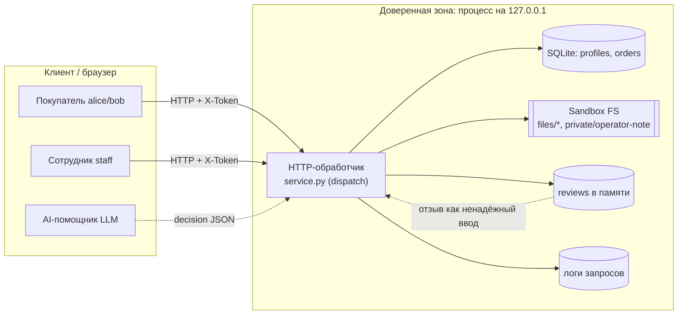

# Модель угроз Mini Shop (ориентир — Microsoft Threat Modeling)

Четыре шага Microsoft: **описать систему → найти угрозы (STRIDE) → меры защиты → проверка**.
Все данные синтетические (`TEST_*`, `example.invalid`), процесс слушает только `127.0.0.1`.

## 1. Описание системы и DFD

Mini Shop — HTTP API на стандартной библиотеке Python. Хранит профили и заказы в
SQLite (`:memory:`), учебные файлы-чеки и служебную заметку — во временном каталоге
(`sandbox.py`). Отдельный эндпоинт готовит контекст для внешнего AI-помощника и
исполняет его «решение» (инструменты `read_file`, `export_profiles`, `delete_tree`).

Границы доверия:
- **B1** клиент ↔ сервер: заголовки (`X-Token`, `X-Role`), query и тело полностью
  контролируются клиентом и не доверенные.
- **B2** сервер ↔ LLM: `decision` от помощника не доверенный (prompt injection через отзывы).
- **B3** физическая граница ФС — её держит `sandbox.py` (не меняем); проверки доступа
  **внутри** границы обязан делать `service.py`.

## 2. Угрозы по STRIDE

| # | STRIDE | Актив / поток | Угроза в исходном коде | Как проявляется |
|---|---|---|---|---|
| V1 | Tampering / Info | SQLite (B1) | SQL-инъекция: `id`, `q`, `order_id` интерполируются в строку запроса | `/profile?id=0 OR 1=1`, `/search?q=%' OR '1'='1` выгружают всю таблицу |
| V2 | Spoofing | все эндпоинты (B1) | Нет аутентификации: токен не проверяется почти нигде | Анонимный доступ к профилям, заказам, файлам, помощнику |
| V3 | Info Disclosure | profiles (B1) | IDOR: `/profile?id=` отдаёт любой профиль | Чтение чужих ПДн (152-ФЗ) |
| V4 | Info Disclosure | orders (B1) | `/orders` возвращает заказы всех владельцев | Утечка чужих заказов |
| V5 | Elevation of Privilege | `/admin/export` (B1) | Авторизация по клиентскому заголовку `X-Role` | Покупатель с `X-Role: staff` выгружает все профили |
| V6 | Info Disclosure | sandbox FS (B3) | `/files?user=&path=` без проверки владельца; `user=..` достаёт `private/operator-note.txt` | Чтение чужих чеков и служебного секрета внутри границы |
| V7 | Tampering | orders (B1) | Цена берётся из тела запроса (`price`) | Покупка стула за 1 ₽ |
| V8 | Tampering (Stored XSS) | `/reviews/view` (B1) | Текст отзыва вставляется в HTML без экранирования | `<script>` исполняется у просматривающего |
| V9 | EoP / Tampering | `/assistant/execute` (B2) | Сервер выполняет любой инструмент из `decision` без авторизации | Prompt injection в отзыве → `delete_tree`, `export_profiles`, чтение чужих файлов; то же прямым JSON |
| V10 | Info Disclosure | `/debug/logs` (B1) | Логи хранят тело (пароли) и заголовки (токены), доступны всем | Кража учёток и сессий |
| V11 | Info Disclosure | обработчик ошибок | 500 возвращает текст и тип исключения | Раскрытие SQL-ошибок и внутренней структуры (помогает V1) |

## 3. Меры защиты (реализованы в `service.py`)

- **Аутентификация (V2):** единый шлюз — все эндпоинты, кроме `/health`, `/products`,
  `/login`, требуют валидную серверную сессию по `X-Token`; неизвестные пути → 404.
- **Авторизация по сессии, не по заголовку (V5):** роль и владелец берутся из
  `self.sessions`, клиентский `X-Role` игнорируется.
- **Параметризованный SQL (V1, V11):** все запросы через `?`-параметры; `id`/`order_id`
  приводятся к `int`; ошибки не раскрываются (500 → «internal error»).
- **Проверка владельца (V3, V4, V6):** покупатель видит только свой профиль, свои
  заказы и каталог `files/<свой>`; запрет `..` и абсолютных путей; служебная заметка
  недостижима через `/files`.
- **Цена из каталога (V7):** клиентский `price` игнорируется.
- **Экранирование вывода (V8):** `html.escape` для текста отзывов.
- **Серверная авторизация инструментов помощника (V9):** каждый инструмент
  авторизуется из сессии независимо от `decision`; `delete_tree`/`export_profiles` —
  только staff; `read_file` — только в своём каталоге. Защита держится, даже если LLM
  поддалась инъекции или `decision` подделан напрямую. В промпте отзывы помечены как
  ненадёжные данные.
- **Редакция логов + staff-only (V10):** из логов удаляются `password`, `X-Token`,
  `Authorization`; `/debug/logs` доступен только сотруднику.

## 4. Проверка

- `make test` — 30 тестов: исходные функциональные + `test_security.py` (14 кейсов,
  включая форсированное опасное `decision` и инъекцию через отзыв).
- `test_security.py` на **исходном** коде даёт 18 провалов + 4 ошибки (угрозы
  выявлены), на **исправленном** — проходит полностью (см. REPORT_01 / REPORT_02).
- Граница ФС (`SandboxTest`) не менялась и остаётся зелёной.
