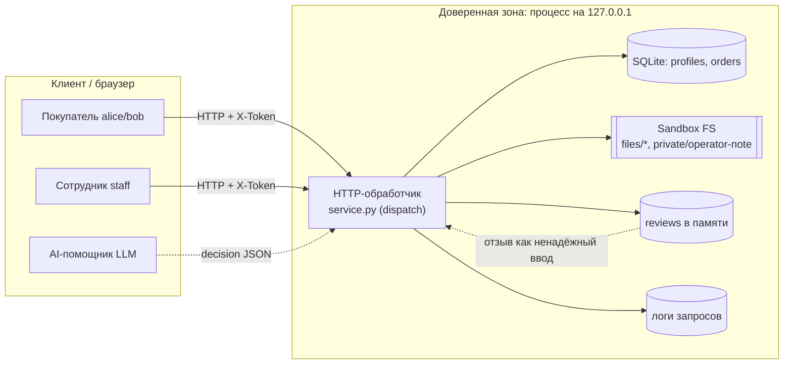

# Модель угроз Mini Shop (ориентир — Microsoft Threat Modeling)

Четыре шага Microsoft: **описать систему → найти угрозы (STRIDE) → меры защиты → проверка**.
Все данные синтетические (`TEST_*`, `example.invalid`), процесс слушает только `127.0.0.1`.

## 1. Описание системы и DFD

Mini Shop — HTTP API на стандартной библиотеке Python. Хранит профили и заказы в
SQLite (`:memory:`), учебные файлы-чеки и служебную заметку — во временном каталоге
(`sandbox.py`). Отдельный эндпоинт готовит контекст для внешнего AI-помощника и
исполняет его «решение» (инструменты `read_file`, `export_profiles`, `delete_tree`).

Границы доверия:
- **B1** клиент ↔ сервер: заголовки (`X-Token`, `X-Role`), query и тело полностью
  контролируются клиентом и не доверенные.
- **B2** сервер ↔ LLM: `decision` от помощника не доверенный (prompt injection через отзывы).
- **B3** физическая граница ФС — её держит `sandbox.py` (не меняем); проверки доступа
  **внутри** границы обязан делать `service.py`.

## 2. Угрозы по STRIDE

| # | STRIDE | Актив / поток | Угроза в исходном коде | Как проявляется |
|---|---|---|---|---|
| V1 | Tampering / Info | SQLite (B1) | SQL-инъекция: `id`, `q`, `order_id` интерполируются в строку запроса | `/profile?id=0 OR 1=1`, `/search?q=%' OR '1'='1` выгружают всю таблицу |
| V2 | Spoofing | все эндпоинты (B1) | Нет аутентификации: токен не проверяется почти нигде | Анонимный доступ к профилям, заказам, файлам, помощнику |
| V3 | Info Disclosure | profiles (B1) | IDOR: `/profile?id=` отдаёт любой профиль | Чтение чужих ПДн (152-ФЗ) |
| V4 | Info Disclosure | orders (B1) | `/orders` возвращает заказы всех владельцев | Утечка чужих заказов |
| V5 | Elevation of Privilege | `/admin/export` (B1) | Авторизация по клиентскому заголовку `X-Role` | Покупатель с `X-Role: staff` выгружает все профили |
| V6 | Info Disclosure | sandbox FS (B3) | `/files?user=&path=` без проверки владельца; `user=..` достаёт `private/operator-note.txt` | Чтение чужих чеков и служебного секрета внутри границы |
| V7 | Tampering | orders (B1) | Цена берётся из тела запроса (`price`) | Покупка стула за 1 ₽ |
| V8 | Tampering (Stored XSS) | `/reviews/view` (B1) | Текст отзыва вставляется в HTML без экранирования | `<script>` исполняется у просматривающего |
| V9 | EoP / Tampering | `/assistant/execute` (B2) | Сервер выполняет любой инструмент из `decision` без авторизации | Prompt injection в отзыве → `delete_tree`, `export_profiles`, чтение чужих файлов; то же прямым JSON |
| V10 | Info Disclosure | `/debug/logs` (B1) | Логи хранят тело (пароли) и заголовки (токены), доступны всем | Кража учёток и сессий |
| V11 | Info Disclosure | обработчик ошибок | 500 возвращает текст и тип исключения | Раскрытие SQL-ошибок и внутренней структуры (помогает V1) |

Угрозы, найденные повторным аудитом **исправленного** кода в новой сессии (см. REPORT_02):

| # | STRIDE | Актив / поток | Угроза в коде после первого фикса | Как проявляется |
|---|---|---|---|---|
| V12 | Denial of Service | обработчик, `/login`, `/orders`, `/assistant/execute` (B1) | Нет проверки формы JSON: `redact_log` зовёт `.items()` у любого тела, `body.get`/`decision.get` у не-объекта, `dict.get(list)`; битый JSON и `Content-Length: abc` | Тело `[1]` или `"x"` → 500 на любом пути, даже `/health`; `{"decision":"x"}` → 500 |
| V13 | Denial of Service (хранимый) | `reviews` → `/reviews/view`, `/assistant/context`, `/debug/logs` | Текст отзыва не проверяется на тип и кодировку; ответ кодируется в UTF-8 **вне** `try` | Отзыв bob `{"text":{"a":1}}` → `/reviews/view` 500 у всех; `"\ud800"` → пустой ответ (обрыв соединения) на просмотре, у помощника alice и в логах staff |
| V14 | Denial of Service / Info | sandbox FS через `/files`, `read_file` (B3) | Ошибки ФС не обрабатываются: пустой путь, каталог, несуществующий файл, NUL-байт | 500 вместо 404/400; оракул «есть/нет» и шум в журнале ошибок |
| V15 | EoP (confused deputy) + Tampering | `/assistant/context` → `/assistant/execute` под staff (B2) | Отзывы **всех** пользователей попадают в контекст любого заказа; у staff `delete_tree` без ограничения пути (пустой/отсутствующий `path` = корень), `read_file` достаёт `private/` | Отзыв bob → контекст заказа alice у сотрудника → `delete_tree` с `{}` уничтожает все чеки и заметку; `read_file private/operator-note.txt` → секрет |
| V16 | Spoofing | сессии, `/login` (B1) | Нет выхода и срока жизни токена, нет ограничения попыток входа, сравнение пароля `!=` | Украденный токен вечен; перебор пароля без ограничений (30 попыток подряд — все 401 без задержки) |
| V17 | Denial of Service | `self.logs`, сокет обработчика | Журнал растёт без предела (пишется до аутентификации, до 64 КБ тела на запрос); у сокета нет таймаута | 2000 анонимных запросов = 120 МБ в памяти; клиент с `Content-Length: 100` и 1 байтом тела держит поток бесконечно |
| V18 | Repudiation | `self.logs` (B1/B2) | Журнал не фиксирует, от чьей сессии пришёл запрос (токен вырезается, а пользователь не пишется) | Удаление файла через помощника под staff неатрибутируемо — нельзя доказать, кто это сделал (выявлено LLM-судьёй) |

## 3. Меры защиты (реализованы в `service.py`)

- **Аутентификация (V2):** единый шлюз — все эндпоинты, кроме `/health`, `/products`,
  `/login`, требуют валидную серверную сессию по `X-Token`; неизвестные пути → 404.
- **Авторизация по сессии, не по заголовку (V5):** роль и владелец берутся из
  `self.sessions`, клиентский `X-Role` игнорируется.
- **Параметризованный SQL (V1, V11):** все запросы через `?`-параметры; `id`/`order_id`
  приводятся к `int`; ошибки не раскрываются (500 → «internal error»).
- **Проверка владельца (V3, V4, V6):** покупатель видит только свой профиль, свои
  заказы и каталог `files/<свой>`; запрет `..` и абсолютных путей; служебная заметка
  недостижима через `/files`.
- **Цена из каталога (V7):** клиентский `price` игнорируется.
- **Экранирование вывода (V8):** `html.escape` для текста отзывов.
- **Серверная авторизация инструментов помощника (V9):** каждый инструмент
  авторизуется из сессии независимо от `decision`; `delete_tree`/`export_profiles` —
  только staff; `read_file` — только в своём каталоге. Защита держится, даже если LLM
  поддалась инъекции или `decision` подделан напрямую. В промпте отзывы помечены как
  ненадёжные данные.
- **Редакция логов + staff-only (V10):** из логов удаляются `password`, `X-Token`,
  `Authorization`; `/debug/logs` доступен только сотруднику.

Меры второго аудита:

- **Строгий разбор ввода (V12):** битый JSON, нечисловой `Content-Length`, не-UTF-8 и
  тело не-объект → `400`; типы `username`/`password`/`product`/`decision`/`arguments`
  проверяются; сериализация ответа перенесена внутрь `try`.
- **Валидация хранимых отзывов (V13):** `product` из каталога, `text` — строка
  1..2000 символов, кодируемая в UTF-8 (одиночные суррогаты отвергаются ещё на входе).
- **Ошибки ФС → 404 (V14):** `read_fixture` ловит `OSError`/`ValueError`; `safe_segment`
  отвергает пустой путь и NUL.
- **Ограничение радиуса staff-инструментов (V15):** `delete_tree` только для
  конкретного элемента внутри `files/<клиент>/…` (корень, `files`, каталог клиента,
  `private/` → 403); `read_file` у staff только в `files/`; в контекст попадают лишь
  отзывы товара этого заказа без `author`. Это сужает инъекцию, но главная защита —
  по-прежнему серверная авторизация в `/assistant/execute`.
- **Жизненный цикл сессии (V16):** `POST /logout`, TTL токена 1 ч, 5 неудачных входов
  за 60 с на имя → `429`, `hmac.compare_digest` для пароля, очистка просроченных сессий.
- **Ограничение ресурсов (V17):** журнал — `deque(maxlen=500)`, таймаут сокета 10 с.
- **Атрибуция действий (V18):** после проверки сессии в запись журнала добавляется
  `user` (имя из сессии, не токен).

## 4. Проверка

- `make test` — **45 тестов, OK**: 16 поставляемых (`test_service`, `test_http`) +
  29 в `test_security.py` (14 в `SecurityTest` для V1–V11, включая форсированное опасное
  `decision` и инъекцию через отзыв; 15 в `ReauditTest`/`ReauditHttpTest` для V12–V18).
- `SecurityTest` на **исходном** коде (`0c8a9c1`) даёт 18 провалов + 4 ошибки.
  `ReauditTest`+`ReauditHttpTest` падают **и на исходном коде, и на первом фиксе**
  (12 провалов + 23 ошибки, падают все 15 методов) — это дыры, которые первая сессия
  пропустила. На текущем коде проходят все 45 (см. REPORT_01 / REPORT_02).
- Граница ФС (`SandboxTest`) не менялась и остаётся зелёной.
